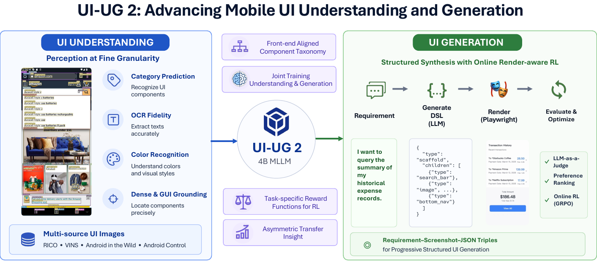
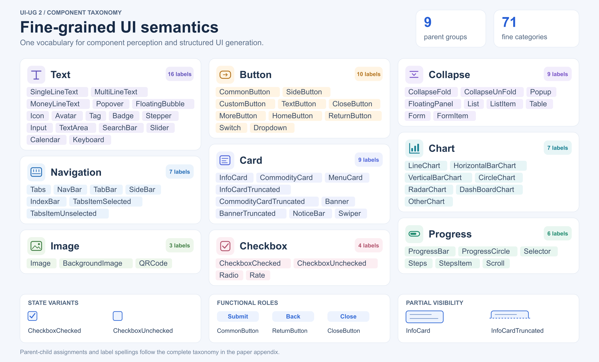
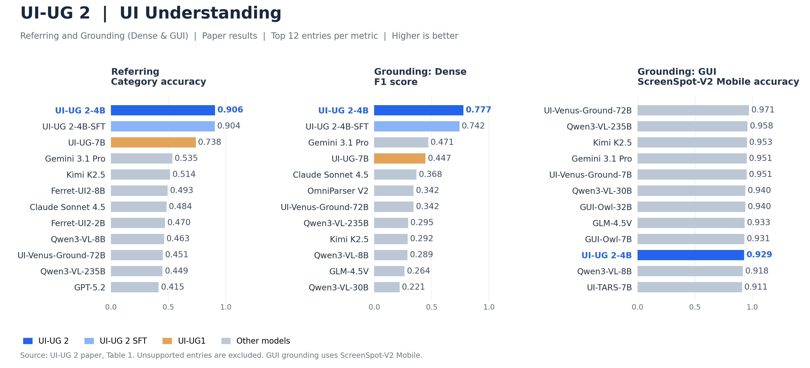
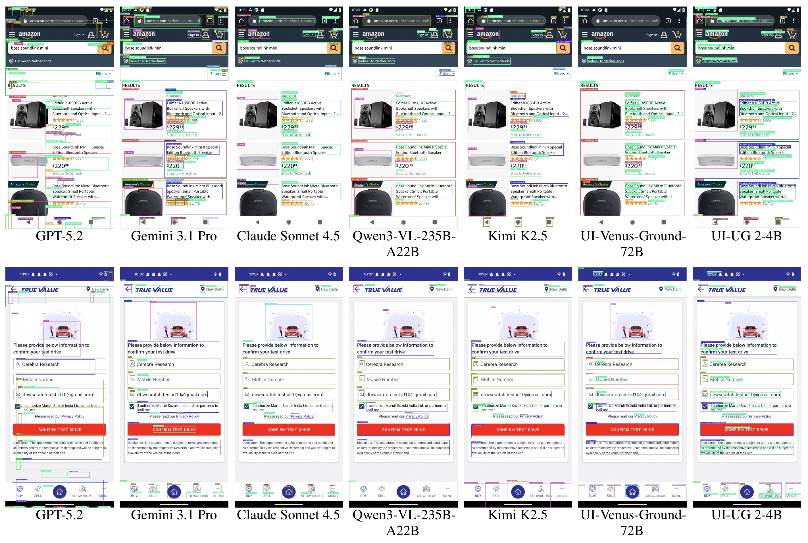
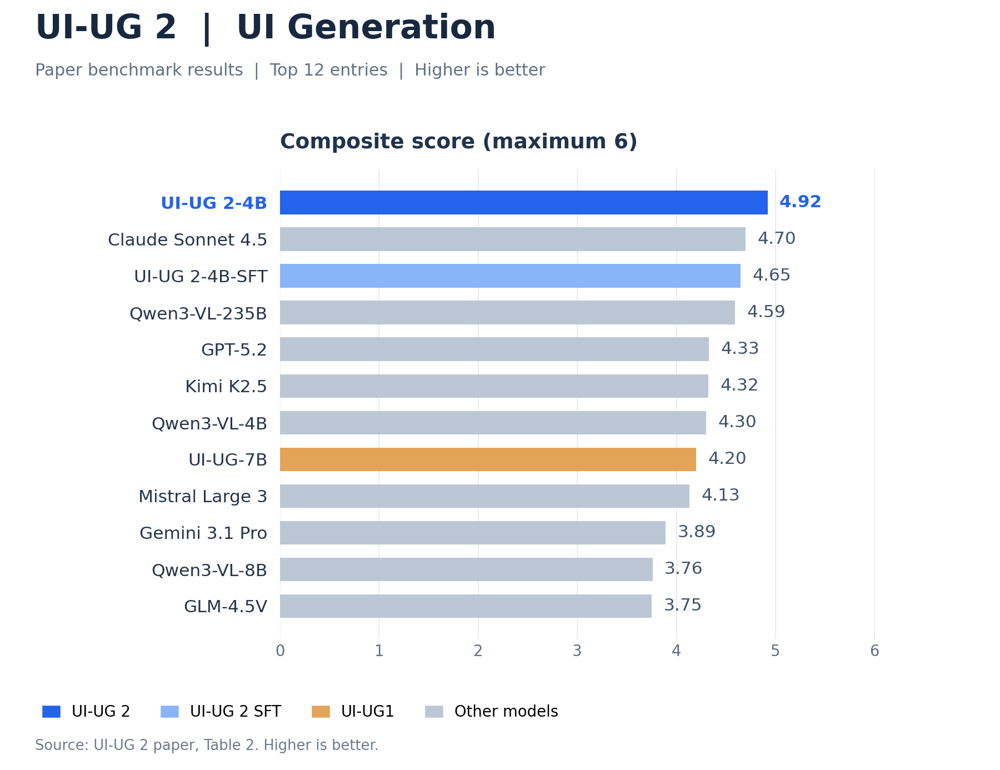
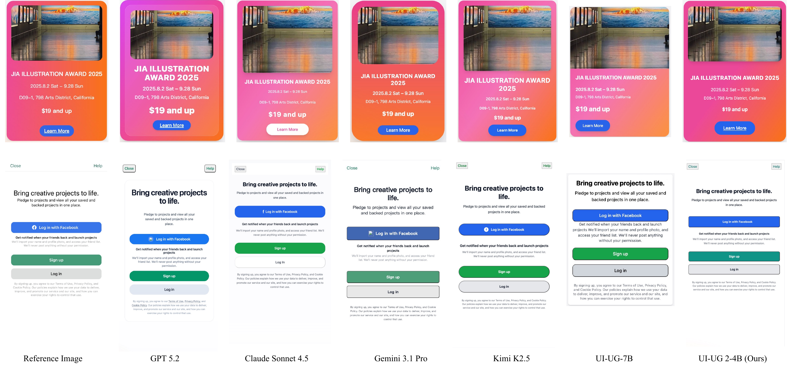

# 🎯 UI-UG 2: Mobile UI Understanding and Generation

[](https://www.python.org/downloads/)
[](LICENSE)
[](papers/UI-UG2.pdf)
[](https://huggingface.co/afx-team/UI-UG2-4B)
[](https://github.com/afx-team/UI-UG)

[**📖 Paper**](papers/UI-UG2.pdf) | [**🤗 Model**](https://huggingface.co/afx-team/UI-UG2-4B) | [**🚀 Quick Start**](#-quick-start-transformers) | [**📄 License**](#-license) | [**🗂️ UI-UG1**](uiug_v1/README.md) | [**📄 UI-UG1 Paper**](https://arxiv.org/abs/2509.24361)

## 🌟 Overview

**UI-UG 2** is a compact **4B-parameter multimodal model** that unifies fine-grained mobile UI understanding and structured UI generation. It combines a Qwen3-VL backbone, a front-end-aligned component taxonomy, expanded grounding capabilities, and online render-aware reinforcement learning.



## 🆕 What changed from UI-UG?

| | UI-UG1 | UI-UG 2 |
|---|---|---|
| Backbone | Qwen2.5-VL, 7B | Qwen3-VL, 4B |
| Understanding | Referring and dense grounding | Referring and Grounding (dense grounding and instruction-conditioned GUI grounding) |
| Taxonomy | 20 categories | 71 fine output labels, grouped into 9 parent classes using the paper's hierarchy |
| Generation post-training | Offline preference optimization with DPO | Online render-aware GRPO with absolute judge scores and contrastive preference ranking |
| Representation | Structured JSON DSL | Retains the renderable JSON DSL and progressive rendering |

This repository provides inference, serving, and JSON DSL rendering. The training recipe is described in the paper; training code is not included.

## 🧩 Fine-grained UI taxonomy

The taxonomy covers **71 fine-grained categories across nine parent groups**, distinguishing component states, functional roles, and partially visible elements.



## 📊 Benchmark highlights

The following charts summarize the results reported in the paper. Each panel shows the top 12 supported entries for its metric under the paper's evaluation protocol.

### 🔍 UI Understanding

UI Understanding consists of Referring and Grounding. Grounding includes dense UI element detection and action-conditioned GUI target localization.



**🖼️ Dense Grounding: qualitative comparison**



Two dense UI cases from the paper, with the same model order in each row. UI-UG 2-4B is shown in the rightmost column.

### 🎨 UI Generation



**🖼️ Generation: qualitative comparison**



Poster card and login interface comparisons from the paper. The reference image is on the left, and UI-UG 2-4B is shown in the rightmost column.

## 🤗 Model and earlier releases

| Version | Model | Code |
|---|---|---|
| UI-UG 2-4B | [afx-team/UI-UG2-4B](https://huggingface.co/afx-team/UI-UG2-4B) | [https://github.com/afx-team/UI-UG](https://github.com/afx-team/UI-UG) |
| UI-UG-7B | [afx-team/UI-UG-7B](https://huggingface.co/afx-team/UI-UG-7B) | [UI-UG1 archive](uiug_v1/README.md) |
| UI-UG-7B-2601 | [afx-team/UI-UG-7B-2601](https://huggingface.co/afx-team/UI-UG-7B-2601) | [UI-UG1 archive](uiug_v1/README.md) |

Weights are downloaded from the model repositories or supplied through a local checkpoint path; model binaries are not stored in this Git repository.

## 🛠️ Installation

Use Python 3.10 or newer with a compatible PyTorch/CUDA environment for GPU inference.

```bash
python -m venv .venv
source .venv/bin/activate
pip install -r requirements.txt
```

For vLLM serving:

```bash
pip install -r requirements-vllm.txt
```

For optional screenshot rendering:

```bash
pip install -r requirements-render.txt
playwright install chromium
```

The dependency minimums follow the upstream [Qwen3-VL installation and deployment guide](https://github.com/QwenLM/Qwen3-VL): Transformers 4.57+ and vLLM 0.11+.

## 🚀 Quick start: Transformers

```bash
export MODEL_PATH=afx-team/UI-UG2-4B
# A local checkpoint directory can also be used for MODEL_PATH.
```

Use your screenshot path in the commands below.

### 🔍 UI Understanding

#### 🔍 Referring

```bash
python -m demo.demo_simple \
  --image path/to/screenshot.png \
  --prompt 'Describe the region [344, 358, 524, 390].'
```

#### 📍 Grounding

**📍 Dense grounding**

All UI items:

```bash
python -m demo.demo_simple \
  --image path/to/screenshot.png \
  --prompt 'List all ui items in the image.'
```

Items from one of the nine parent categories, for example `Button`:

```bash
python -m demo.demo_simple \
  --image path/to/screenshot.png \
  --prompt 'List all Button items in the image.'
```

Items from one of the 71 subcategories, for example `CommonButton`:

```bash
python -m demo.demo_simple \
  --image path/to/screenshot.png \
  --prompt 'List all CommonButton items in the image.'
```

Replace `Button` or `CommonButton` with another parent category or subcategory.

**🎯 GUI grounding**

```bash
python -m demo.demo_simple \
  --image path/to/screenshot.png \
  --prompt 'Detect the bounding box of the UI element corresponding to the action: Tap the search button.'
```

### 🎨 UI Generation

```bash
python -m demo.demo_simple \
  --prompt 'Generate a login form with email field, password field, and submit button' \
  --output generated_ui.json
```

Add `--image path/to/reference.png` to provide a reference image.

## ⚡ Serving and API inference

```bash
MODEL_PATH=afx-team/UI-UG2-4B bash scripts/vllm_deploy.sh
```

**🎯 UI Understanding / Grounding / GUI grounding**

```bash
python -m demo.run_demo \
  --image path/to/screenshot.png \
  --prompt 'Detect the bounding box of the UI element corresponding to the action: Tap the search button.'
```

**🎨 UI Generation**

```bash
python -m demo.run_demo \
  --prompt 'Generate a login form with email field, password field, and submit button' \
  --stream
```

Use the same prompts above with `python -m demo.run_demo` for API inference.

The server defaults to `127.0.0.1:8000` with served model name `uiug2`. Configure `MODEL_PATH`, `HOST`, `PORT`, `TENSOR_PARALLEL_SIZE`, or `VLLM_API_BASE` as needed. See [.env.example](.env.example). Authentication, when required by a model repository, uses your normal Hugging Face credentials.

## 🎨 JSON DSL rendering

```bash
python -m utils.render_utils \
  --input examples/ui_card.json \
  --html rendered_card.html
```

Add `--tailwind-css /path/to/compiled.css` for Tailwind styles and `--png rendered_card.png` to launch Chromium for a screenshot. Use `--font /path/to/font.ttf` for a custom font. The included Python renderer supports `Tag` nodes and data bindings; `Component` nodes require the corresponding front-end component runtime, which is not bundled here.

## 🤝 Acknowledgments

- [**Qwen3-VL**](https://github.com/QwenLM/Qwen3-VL) - Multimodal foundation model
- [**vLLM**](https://github.com/vllm-project/vllm) - High-performance inference framework
- [**Ant Group**](https://www.antgroup.com) & [**AFX Team**](https://afx-team.github.io) - Technical support and scenario applications

## 📖 Citation

Please cite the version relevant to your work.

```bibtex
@misc{yang2026uiug2,
  title={UI-UG 2: Advancing Mobile UI Understanding and Generation with Fine-Grained Supervision and Reinforcement Learning},
  author={Hao Yang and Shuoyang Liu and Xiaoyu Lin and Zhou Fang and Maji Huang and Zhaosong Huang and Ruichao Mao and Teng Guo and Hai Rao},
  year={2026},
  note={Preprint}
}

@misc{yang2025uiugunifiedmllmui,
  title={UI-UG: A Unified MLLM for UI Understanding and Generation},
  author={Hao Yang and Weijie Qiu and Ru Zhang and Zhou Fang and Ruichao Mao and Xiaoyu Lin and Maji Huang and Zhaosong Huang and Teng Guo and Shuoyang Liu and Hai Rao},
  year={2025},
  eprint={2509.24361},
  archivePrefix={arXiv},
  primaryClass={cs.CV},
  url={https://arxiv.org/abs/2509.24361}
}
```

## 📄 License

Repository code retains the [Apache 2.0 license](LICENSE) and the existing [legal notice](LEGAL.md). Refer to the corresponding model cards for checkpoint terms and to the paper's distribution terms for the manuscript.

---

*Built with ❤️ by [Alipay AFX](https://afx-team.github.io/)*
