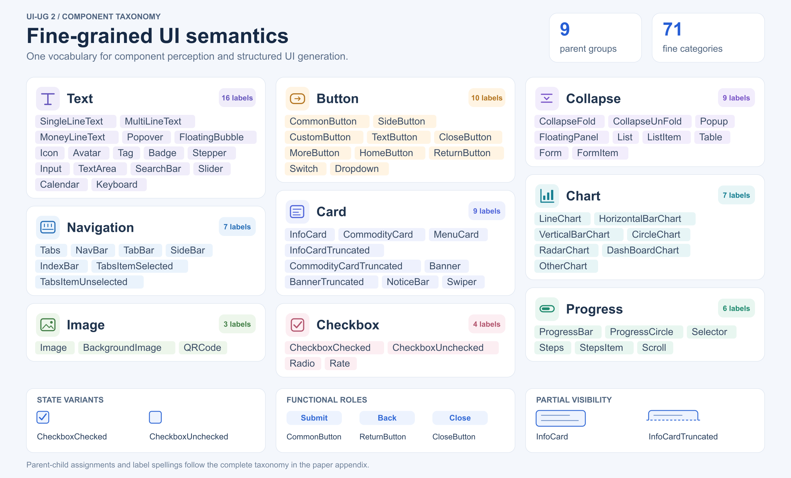

# UI-UG 2 taxonomy

The complete taxonomy follows the paper appendix: **71 fine output labels grouped into nine parents**. Parent groups are not added to the fine-label vocabulary. In particular, `Image` is both a valid fine label and the name of its parent group.

| Parent | Fine labels | Count |
|---|---|---|
| Card | `InfoCard`, `CommodityCard`, `MenuCard`, `InfoCardTruncated`, `CommodityCardTruncated`, `Banner`, `BannerTruncated`, `NoticeBar`, `Swiper` | 9 |
| Collapse | `CollapseFold`, `CollapseUnFold`, `Popup`, `FloatingPanel`, `List`, `ListItem`, `Table`, `Form`, `FormItem` | 9 |
| Chart | `LineChart`, `HorizontalBarChart`, `VerticalBarChart`, `CircleChart`, `RadarChart`, `DashBoardChart`, `OtherChart` | 7 |
| Navigation | `Tabs`, `NavBar`, `TabBar`, `SideBar`, `IndexBar`, `TabsItemSelected`, `TabsItemUnselected` | 7 |
| Progress | `ProgressBar`, `ProgressCircle`, `Selector`, `Steps`, `StepsItem`, `Scroll` | 6 |
| Button | `CommonButton`, `SideButton`, `CustomButton`, `TextButton`, `CloseButton`, `MoreButton`, `HomeButton`, `ReturnButton`, `Switch`, `Dropdown` | 10 |
| Text | `SingleLineText`, `MultiLineText`, `MoneyLineText`, `Popover`, `FloatingBubble`, `Icon`, `Avatar`, `Tag`, `Badge`, `Stepper`, `Input`, `TextArea`, `SearchBar`, `Slider`, `Calendar`, `Keyboard` | 16 |
| Image | `Image`, `BackgroundImage`, `QRCode` | 3 |
| Checkbox | `CheckboxChecked`, `CheckboxUnchecked`, `Radio`, `Rate` | 4 |

## Label names

- Fine labels are case-sensitive and preserve the appendix spellings, including `DashBoardChart` and `CollapseUnFold`.
- Parent names describe the hierarchy; element categories use the 71 fine labels.
